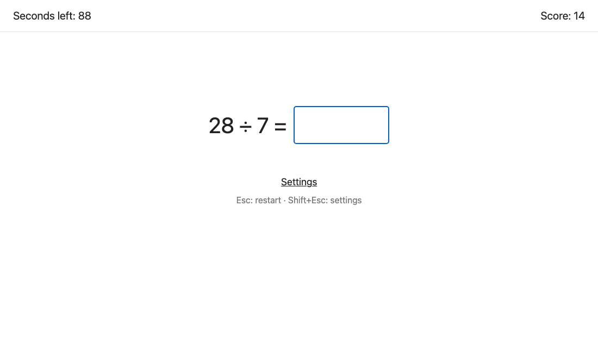
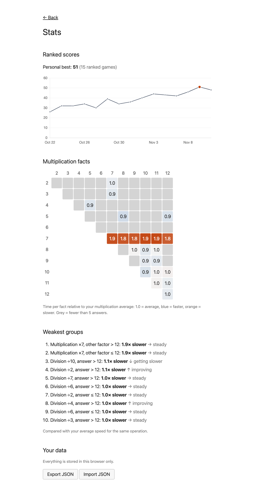

# Detamac

An arithmetic speed drill that runs entirely in your browser. You get a stream of addition, subtraction, multiplication and division problems and answer as many as you can before the timer runs out. A correct answer moves you on as soon as you type it. Detamac keeps the plain, fast format of classic arithmetic drills and adds a practice mode that gives you more of the question types you're slow on.

**Play:** <https://sanil425.github.io/detamac-game/>



## Controls

- **Type the answer.** There's no Enter: a correct answer is accepted the moment it's typed, and a wrong one just sits there until you fix it.
- **Esc** during a round restarts immediately with the same mode and settings.
- **Shift+Esc** during a round (or the "Settings" link under the problem) goes back to the settings screen.
- On the results screen, **Enter** or **Esc** plays again and **Shift+Esc** goes to settings.

A round you leave early (restart, settings, or closing/hiding the tab) records no score. Its answers still count toward your stats; a ranked round's answers count as practice.

## Modes

- **Ranked:** fixed default settings (addition 2–100 + 2–100, multiplication 2–12 × 2–100, subtraction and division as their reverses), 120 seconds, and purely random questions. The adaptive model never influences ranked questions. Finished rounds are saved to your score history.
- **Practice:** choose your operations, ranges and duration (30 s to 10 min). Questions are picked adaptively (see below). The game screen never shows which questions were targeted.

The stats page shows your ranked scores over time (with your personal best), a multiplication heatmap, and your weakest question types. You can export and import your data as JSON. Everything is stored in your browser's localStorage. Nothing is sent anywhere.



## How it adapts

### Groups

Every question falls into exactly one group that describes what makes it hard:

- **Addition:** carry or no carry × digit pattern (1+1, 1+2, 2+2, 3+) × sum ≤ 100 or > 100. Impossible combinations (such as 1+1 with a sum over 100) never appear.
- **Subtraction:** borrow or no borrow × first number ≤ 100 or > 100.
- **Multiplication:** the smaller factor (×2, ×3, … ×20, then "21+") × the other factor ≤ 12 or > 12.
- **Division:** the divisor (same buckets) × answer ≤ 12 or > 12.

Multiplications with both factors in 2–12 also update a per-fact stat (7×8 and 8×7 are the same fact), shown in the heatmap. Groups work for any custom range, not just the defaults.

### Weakness is relative to the operation's average

For each group, fact and operation, Detamac keeps an exponentially weighted moving average (EWMA) of your answer time. Each new answer moves it 20% of the way toward the new time, so recent answers count most. A second, slower average (5%) is compared with it to show whether a group is improving.

A group's **weakness** is its average divided by your average for that operation. Division is usually slower than addition, so comparing raw times would make every division group look weak. Measured against its own operation, "1.8× slower" means 80% slower than your typical answer of the same kind.

Ranked answers update the averages at full strength. Practice answers count half as much, because a session focused on your weak spots isn't a typical sample. The first question of each round (you're still settling in) and answers over 15 seconds (you got distracted) are ignored.

### Choosing practice questions

For the first 100 answers, practice is uniform random. After that, each question is chosen in two steps:

1. **Pick an operation.** Each operation's share is a 50/50 blend of an equal share and its share of your total answer time. Slow operations get more questions, but only up to a point: every share stays between half and double the equal share (12.5%–50% with all four enabled).
2. **Pick a group.** 65% of the time, pick a group in proportion to its weakness. Groups with fewer than 5 answers get a boost so they get explored, and only groups your current ranges can produce are eligible. The other 35% of the time, ask a plain random question for that operation.

A question inside the chosen group is generated by drawing random questions from your ranges until one matches. The same question never appears twice in a row.

### Typing correction, and the bug the simulation caught

A 3-digit answer takes longer to type than a 1-digit one, and that isn't an arithmetic weakness. Detamac estimates the extra time per digit, `b`, and subtracts `b × digits` from every answer time before it reaches the averages. The fit uses least squares and stores only running sums, never raw answers. It switches on after 30 answers, once at least two answer lengths have 5+ answers each.

The first version fitted one line, `time ≈ a + b × digits`, across all answers. A simulation test caught a problem with it. The test plays a made-up player for 3,000 practice questions: a 2-second base time, doubled on ×7 multiplication, 1.5× on division, plus exactly 300 ms per answer digit. The single line estimated **47 ms per digit** instead of 300.

The cause is confounding. Division is the slowest operation, but its answers are short (1–2 digits), while multiplication answers run to 3–4 digits. Across all answers together, long answers therefore *look* fast, and a single line puts the operation's speed into the per-digit cost. With real players the correction would have quietly done almost nothing.

The fix gives every operation its own baseline: `time ≈ a(operation) + b × digits`, with one shared `b`. The fit now compares long and short answers *within* each operation, so "division is slow" stays in division's baseline and `b` measures only typing. On the same simulation it recovers **281 ms per digit**.

### Evidence from the simulation

From `npm test`, the simulated player after 3,000 practice questions (default settings):

```text
Operation shares (model target / observed after warm-up):
  addition        23.3% / 24.7%
  subtraction     23.6% / 22.8%
  multiplication  24.3% / 24.4%
  division        28.8% / 28.1%
Typing fit slope: 280.7 ms/digit
Top 5 weakest groups:
  1. Multiplication ×7, other factor > 12: 1.92×
  2. Multiplication ×7, other factor ≤ 12: 1.86×
  3. Division ÷6, answer > 12: 1.06×
  4. Addition, 2+2 digits, no carry, sum > 100: 1.04×
  5. Addition, 1+1 digits, with carry, sum ≤ 100: 1.04×
```

Division, the slowest operation, gets more than its equal 25% but stays under the 50% cap. The two ×7 groups top the weakness list at close to their true 2× slowdown, and every other group sits near 1.0×.

## Run locally

Requires Node 20.19+ (CI uses Node 24).

```sh
npm install
npm run dev      # start the dev server
npm test         # unit tests (Vitest), including the simulated-player test
npm run test:e2e # browser tests (Playwright); first run: npx playwright install chromium
npm run build    # type-check and build to dist/
```

In dev mode (`npm run dev`), the stats page has a "Load demo data" button that fills it with the simulated player's history. It isn't included in the production build.

Pushing to `main` runs all tests and, if they pass, deploys to GitHub Pages via `.github/workflows/deploy.yml`.

## Layout

- `src/core/`: pure TypeScript game logic and the adaptive model, with unit tests next to each file.
- `src/ui/`: React components on top of the core.
- `e2e/`: Playwright tests in which a bot plays the game with a fake clock.

## License

MIT
